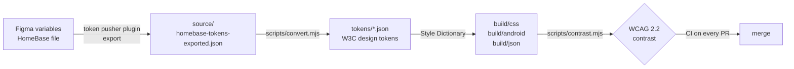

# HomeBase tokens

Design tokens for **HomeBase**, a concept smart home app for Android (Material 3 and Matter). The tokens start as Figma variables and end up as CSS custom properties and Android colour resources, built with [Style Dictionary](https://styledictionary.com) and checked against WCAG contrast rules on every change.

> **Status:** personal concept project. The tokens are not used in any production product. The case study is at [marcinpociask.com/homebase-smart-home-app](https://www.marcinpociask.com/homebase-smart-home-app).

## Pipeline



1. **Export** the variables from Figma to JSON with a custom plugin.
2. **Convert** the export into W3C design-token files, one per collection and mode.
3. **Build** with Style Dictionary into CSS variables (light, dark, base, wireframe font), Android `colors.xml` (`values` and `values-night`) and resolved JSON.
4. **Check** foreground/background pairs for contrast. GitHub Actions runs the build and the check on every push and pull request.

## What's in it

| Collection | Tokens | Modes |
|---|---|---|
| M3 (Material 3 colour roles, palettes, surfaces, state layers) | 311 | Light, Dark |
| Home Base (status, status text, energy, gradient colours) | 16 | Light, Dark |
| Shape (corner radius, spacing, touch targets) | 19 | none |
| Font theme | 7 | Baseline, Wireframe |
| Typescale | 90 | none |

Aliases are kept: typescale tokens reference the font theme, and some Home Base colours reference M3 palettes. In the CSS they come out as `var(--...)`, so switching a mode or the font theme cascades through.

## Use it

```bash
npm install
npm test          # build + contrast check
npm run build     # build only
npm run convert   # regenerate tokens/ from source/ (when the Figma export changes)
```

CSS usage:

```html
<link rel="stylesheet" href="build/css/base.css">
<link rel="stylesheet" href="build/css/theme-light.css">
<link rel="stylesheet" href="build/css/theme-dark.css">   <!-- applies under [data-theme="dark"] -->
<link rel="stylesheet" href="build/css/font-wireframe.css"> <!-- applies under [data-font-theme="wireframe"] -->
```

## Contrast check

`config/contrast-pairs.json` lists the text/background pairs to test (Material 3 roles and the Home Base status chips). Colours with alpha are composited over the surface before measuring.

Known failures are recorded in `config/known-issues.json`. The check passes while they are open, fails on any new failure, and fails if a known issue is fixed but still listed, so the list cannot go stale.

**Resolved:** status text on its tinted background in light mode was below 4.5:1 (operational 2.98, warning 1.97, critical 3.41, neutral 3.02), finding A-01 from an expert-review audit of the Room Card component. The new `Status Text` tokens fix it (`#16795A`, `#9A610B`, `#CE2221`, `#696862`, each 4.6:1 or better on its tint). In dark mode they alias the existing status colours, which already passed. The original `Status` colours stay for fills and icons.

## Roadmap

- Add the new `Status Text` variables to the Figma file (token pusher, Push), so the file and the repo agree.
- Check the status colours used as icons or dots against the 3:1 non-text contrast rule (warning is about 2:1 on its tint).
- Composite typography tokens from the 44 Figma text styles.
- Write the repo's tokens back to Figma as variables, to close the loop.
- A small preview page for the tokens.

## Credits

The Material 3 colour roles and type scale follow Google's [Material Design 3](https://m3.material.io) (Apache 2.0). The HomeBase colour, shape and spacing tokens are my own.

## Licence

[MIT](LICENSE)
